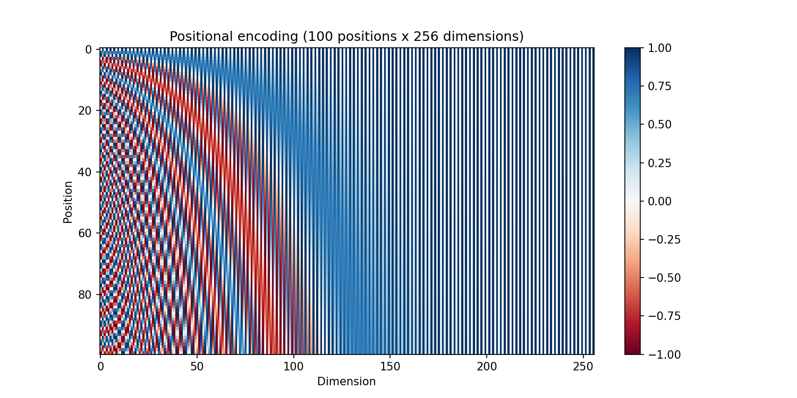
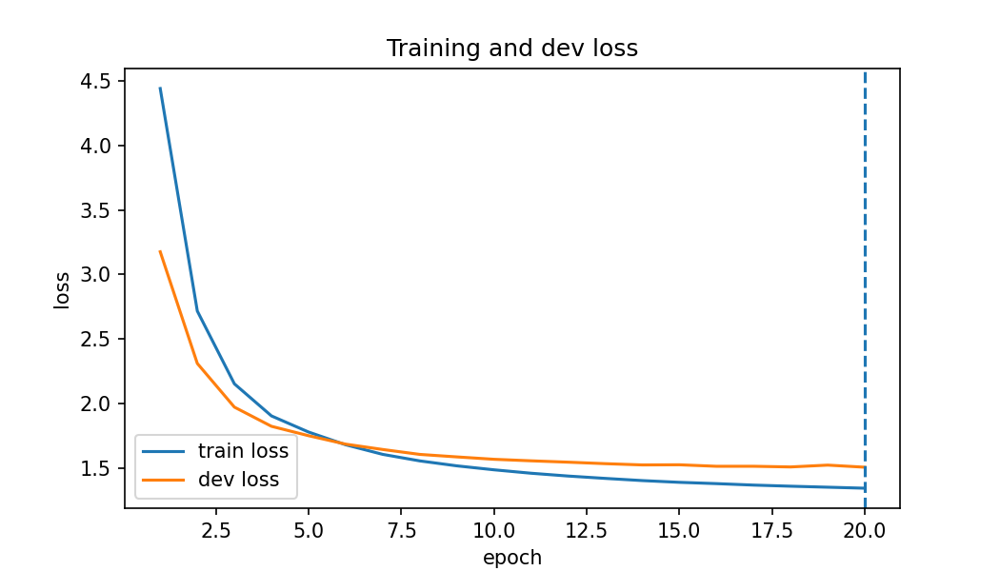
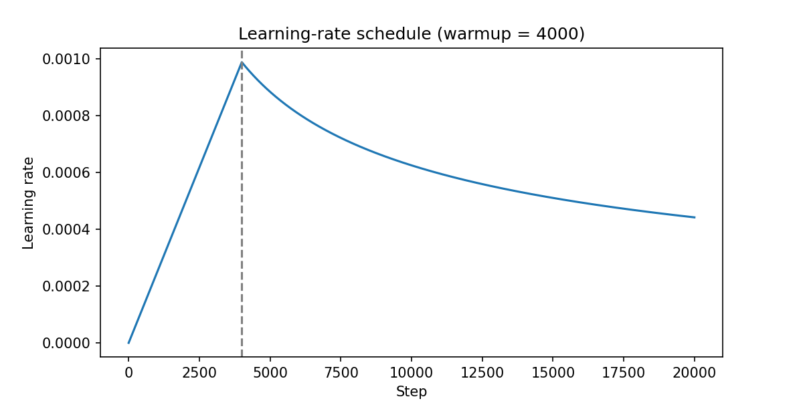
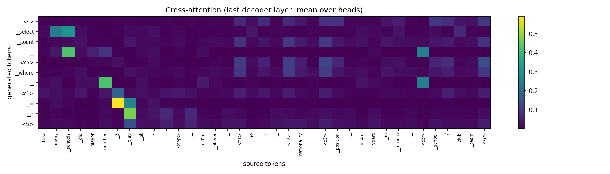
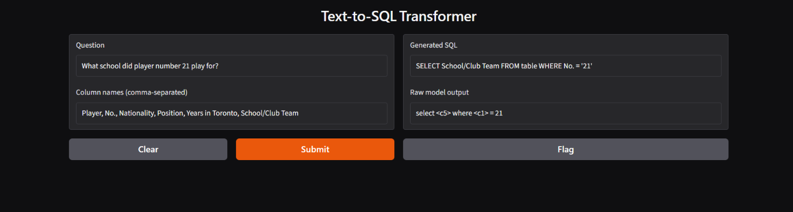

<!--
BEFORE SUBMITTING (delete this comment):
1. Rewrite the prose in your own words. Keep the numbers, tables and command lines.
2. Replace every [PLACEHOLDER].
3. Test the "How to run" commands from a fresh clone and fix anything that does not work.
-->

# Text-to-SQL with a Transformer built from scratch

Generative AI, Assignment 2, Fall 2026, NUCES.

An English question about a table goes in, and a SQL query comes out. The model is the encoder-decoder Transformer from *Attention Is All You Need* (Vaswani et al., 2017), written from basic PyTorch layers and trained from random initialisation on WikiSQL. No pretrained weights and no ready-made Transformer modules are used.

Example (table columns: Player, No., Nationality, Position, Years in Toronto, School/Club Team):

| | |
|---|---|
| Question | What school did player number 21 play for? |
| Generated SQL | `SELECT School/Club Team FROM table WHERE No. = '21'` |

**Team:** Abeera Imran

**Links:** Medium blog: [[PLACEHOLDER]](https://medium.com/@abeera.syal989/teaching-a-transformer-to-write-sql-a-text-to-sql-model-built-from-scratch-4e73c0707244?postPublishedType=repub) | LinkedIn post: [[PLACEHOLDER]](https://www.linkedin.com/feed/update/urn:li:activity:7512805700901937152/)

## Repository layout

```
starter/              the given files and check_starter.py, unchanged
model/attention.py    scaled dot-product attention and multi-head attention
model/layers.py       feed-forward, encoder layer, decoder layer
model/transformer.py  encoder, decoder, masks, full model
train.py              training loop (Task 3)
decode.py             greedy decoding, beam search, parser, readable SQL
evaluate_model.py     prediction files, component accuracy, attention map
checks.py             correctness checks (masks, attention rows, weight sharing)
app/app.py            Gradio front end
results/              prediction files, evaluator outputs, figures, samples.md
checkpoints/best.pt   trained weights (best dev loss)
sql_sp.model/.vocab   shared 8,000-piece BPE vocabulary
```

## Setup

```
pip install torch sentencepiece records babel tqdm tabulate matplotlib gradio
git clone https://github.com/salesforce/WikiSQL
cd WikiSQL && tar xvjf data.tar.bz2 && cd ..
```

Run every command below from the repository root. The WikiSQL folder (about 3 GB) is not in this repository.

## How to run

Regenerate the training pairs and the tokenizer (the pair files are not stored in the repo):

```
python starter/data_prep.py
python starter/tokenizer.py
python starter/check_starter.py
```

Train (20 epochs; resumes from `checkpoints/last.pt` if it exists). This writes `checkpoints/best.pt` and `results/training_log.json`, so back up the shipped files first if you want to keep them:

```
python train.py 20
```

Write predictions, then score them with the official WikiSQL evaluator:

```
python evaluate_model.py dev_greedy
python evaluate_model.py dev_beam
python WikiSQL/evaluate.py WikiSQL/data/dev.jsonl WikiSQL/data/dev.db results/pred_dev_greedy.jsonl
python WikiSQL/evaluate.py WikiSQL/data/dev.jsonl WikiSQL/data/dev.db results/pred_dev_beam.jsonl
```

Component accuracy, the attention map and the correctness checks:

```
python evaluate_model.py components
python evaluate_model.py attention
python checks.py
```

Front end (opens at http://127.0.0.1:7860 and also prints a temporary public link):

```
python app/app.py
```

The test set was used once. `python evaluate_model.py test_greedy` refuses to run again if `results/pred_test_greedy.jsonl` already exists.

## Model and training setup

| Setting | Value |
|---|---|
| d_model / heads | 256 / 4 (d_k = d_v = 64) |
| Encoder / decoder layers | 3 / 3 |
| Feed-forward size | 1024 |
| Dropout | 0.1 |
| Normalisation | post-norm, LayerNorm(x + Sublayer(x)) |
| Weight sharing | encoder embedding = decoder embedding = output projection |
| Loss | cross-entropy, label smoothing 0.1, ignoring `<pad>` |
| Optimiser | Adam (beta1 0.9, beta2 0.98, eps 1e-9) |
| Learning rate | warmup 4000 steps, then decay with step^-0.5 |
| Batch size / epochs | 64 / 20 |

Decoding stops at `</s>` or after 64 tokens. Beam search uses beam size 4 and ranks hypotheses by the sum of log-probabilities, with no length normalisation.

## Results

### Table 1: Data

Token counts include `</s>` on the source and `<s>` and `</s>` on the target.

| | Train | Dev | Test |
|---|---|---|---|
| Pairs | 56,355 | 8,421 | 15,878 |
| Mean / max source length (tokens) | 42.55 / 222 | 42.49 / 167 | 42.67 / 260 |
| Mean / max target length (tokens) | 14.77 / 65 | 14.79 / 44 | 14.93 / 46 |
| Pairs dropped as too long | 19 | - | - |

`check_starter.py` printed: src (64, 136), tgt (64, 25), encoder input (64, 136, 256), decoder input (64, 24, 256).

### Table 2: Model and training

| | |
|---|---|
| Trainable parameters | 7,577,600 (embedding 2,048,000; encoder 2,369,280; decoder 3,160,320) |
| Epochs trained / best epoch | 20 / 20 |
| Best dev loss | 1.5064 |
| Training time and GPU | 1301 s (about 21.7 min), Tesla T4 |

### Table 3: Official metrics

| Split | Decoding | Logical form (%) | Execution (%) | Parse failures (%) |
|---|---|---|---|---|
| Dev | greedy | 53.98 | 61.48 | 0.67 |
| Dev | beam (4) | 53.95 | 61.47 | 1.20 |
| Test | greedy | 53.92 | 61.27 | 0.64 |

The raw evaluator outputs are in `results/dev_eval_greedy.txt`, `results/dev_eval_beam.txt` and `results/test_eval_greedy.txt`.

### Table 4: Component accuracy (dev)

| | Greedy | Beam (4) |
|---|---|---|
| sel column correct (%) | 82.41 | 81.97 |
| agg correct (%) | 88.45 | 88.14 |
| WHERE clause correct (%) | 66.43 | 66.41 |
| All three correct (%) | 53.98 | 53.95 |

"All three correct" equals the official logical-form accuracy, which confirms that the component code agrees with the evaluator.

## Figures

**Figure 1: positional encoding** (first 100 positions by 256 dimensions)



[PLACEHOLDER: two sentences. Idea: each row is a position, each column a dimension; low dimensions change quickly with position and high dimensions change slowly, so every position gets its own pattern.]

**Figure 2: training and dev loss per epoch**



Train loss fell from 4.44 to 1.34 and dev loss from 3.18 to 1.51. Dev loss is below train loss for epochs 1 to 5 and the curves cross at epoch 6. Dev loss rose slightly at epochs 15 and 19, and epoch 20 had the lowest dev loss.

**Figure 3: learning-rate schedule** (first 20,000 steps)



The rate rises linearly for 4000 steps (9.88e-4 at step 4000) and then decays as step^-0.5 (4.42e-4 at step 20,000).

**Figure 4: cross-attention map** (last decoder layer, averaged over the 4 heads, dev example 1: "How many schools did player number 3 play at?")



[PLACEHOLDER: describe what you see. In this one example the row before `<c5>` attends most to "schools", the row before `<c1>` to "number", and the row before the value to "3". This is one example and a head average, so describe it as consistent with, not proof of, the model using those words.]

**Figure 5: front end**



## Correctness checks

Output of `python checks.py` (saved in `results/correctness_checks.txt`):

```
1. causal mask
   difference at earlier positions: 0.0 (must be 0.0)
   difference at the last position: 4.169147968292236 (must be clearly above 0)
2. padding mask
   max output difference: 0.0 (must be 0.0 or about 1e-6)
3. attention rows
   all rows sum to 1: True
   largest weight on the 6 <pad> columns: 0.0 (must be about 0)
4. weight sharing
   encoder embedding is output weight: True
   decoder embedding is output weight: True
```

- **Learning rate:** see Figure 3. Values: step 1 = 2.47e-07, step 2000 = 4.94e-04, step 4000 = 9.88e-04, step 20000 = 4.42e-04.
- **Gold round-trip:** the dev gold targets were passed through `parse_sql` and the official evaluator (`results/gold_roundtrip_eval.txt`): execution accuracy 1.0 and logical-form accuracy 1.0 on all 8,421 examples.

## Qualitative samples and failure cases

Ten dev examples (five correct, five wrong, each wrong one with its failure named) are in [`results/samples.md`](results/samples.md).

Failure breakdown of the 3,875 wrong dev predictions (greedy). One prediction can have several problems, so the shares add to more than 100%.

| Component wrong | Count | Share of wrong predictions |
|---|---|---|
| WHERE clause (any kind) | 2,771 | 71.5% |
| of which wrong WHERE column | 1,676 | 43.3% |
| of which wrong value or operator | 650 | 16.8% |
| of which wrong number of conditions | 445 | 11.5% |
| SELECT column | 1,425 | 36.8% |
| Aggregate | 917 | 23.7% |
| Parse failure | 56 | 1.4% |

The WHERE clause is the weakest part. Several of the wrong examples come from tables with near-duplicate column names, such as `Capital (endonym)` and `Capital (exonym)`.

## Notes

- Training ran on two Colab accounts. Epoch 1 ran on one account and epochs 2 to 20 on a teammate's Tesla T4, because the first account's free GPU quota ran out. The 1301 s in Table 2 covers all 20 epochs.
- The shared embedding is re-initialised with standard deviation d_model^-0.5 and a zeroed pad row. With the default initialisation the first dev loss was 197.
- Test used greedy decoding. On dev, beam search gave no gain (61.47% against 61.48% execution accuracy) and took about 10.5 minutes instead of 27 seconds. Beam also had more parse failures (1.20% against 0.67%); the cause has not been investigated.
- The training targets are lowercased, so predicted values come out in lowercase. The official evaluator still scores them correctly, as the gold round-trip shows.
- The test set was run once, and its output is in `results/test_eval_greedy.txt`.
- For context, the assignment puts the LSTM seq2seq baseline at about 36% execution accuracy on test.
- The front end calls the trained model with greedy decoding.

## References

- Vaswani et al., *Attention Is All You Need*, 2017. https://arxiv.org/abs/1706.03762
- Zhong, Xiong and Socher, *Seq2SQL: Generating Structured Queries from Natural Language using Reinforcement Learning* (WikiSQL), 2017. https://arxiv.org/abs/1709.00103
- WikiSQL data and official evaluator: https://github.com/salesforce/WikiSQL
